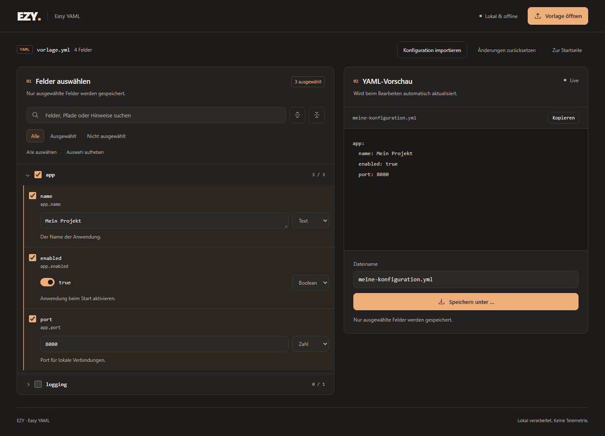

# EZY – YAML übersichtlich bearbeiten

EZY öffnet YAML-Vorlagen als Formular in Visual Studio Code. Felder auswählen, Werte anpassen und direkt sehen, welche YAML gespeichert wird. Bestehende Konfigurationen lassen sich importieren und gezielt ergänzen.

**Lokal und offline.** Ohne Konto, Server oder Telemetrie. Für Desktop-VS-Code ab Version 1.85.



## Was EZY kann

- **Gezielt konfigurieren:** Nur ausgewählte Felder und ihre benötigten Eltern werden gespeichert.
- **Werte bequem bearbeiten:** Text, Zahlen, Boolean-Werte, verschachtelte Gruppen und Listen.
- **Den Überblick behalten:** Suche und Auswahlfilter helfen auch bei umfangreichen Vorlagen.
- **Hinweise direkt am Feld:** Kommentare aus der Vorlage bleiben als Hilfetext sichtbar.
- **Ergebnis direkt mitnehmen:** Als YAML-Datei speichern oder in die Zwischenablage kopieren.

## Installieren

Veröffentlichte VSIX-Pakete stehen unter [Releases](https://github.com/KingTiki/ezy-easyYaml/releases) bereit. In VS Code **Extensions: Install from VSIX…** aufrufen und die heruntergeladene Datei auswählen. Nach einem Update **Developer: Reload Window** ausführen.

Alternativ aus dem Quellcode bauen; dafür sind Node.js ab 22 und npm erforderlich:

```sh
npm ci
npm run package
```

Das Paket `ezy-easy-yaml-<Version>.vsix` liegt anschließend im Projektordner. Eine Marketplace-Veröffentlichung gibt es derzeit nicht.

## In vier Schritten zur Konfiguration

1. **EZY: Konfigurator öffnen** in der Befehlspalette ausführen. Eine YAML-Datei lässt sich auch per Rechtsklick **Mit EZY als Vorlage öffnen**.
2. **Vorlage öffnen** wählen, zum Beispiel [examples/template.yml](examples/template.yml).
3. Felder auswählen und Werte bearbeiten. Über **Konfiguration importieren** kann eine vorhandene Datei als Arbeitsstand übernommen werden.
4. Vorschau prüfen und **Speichern unter …** oder **Kopieren** wählen.

Die Vorlage wird nicht automatisch überschrieben. Die vollständige [Bedienungsanleitung](docs/BEDIENUNG.md) beschreibt Listen, Filter und Arbeitsstand.

## Gut zu wissen

- Kommentare und ursprüngliche Formatierung werden nicht mitgespeichert. Auskommentierte Felder bleiben Hilfetext.
- Der Arbeitsstand bleibt beim Tabwechsel erhalten. Beim Schließen des EZY-Tabs endet die Sitzung; es gibt kein Autosave.
- Unterstützt wird ein YAML-Dokument mit Objektwurzel bis 5 MB. Anker, Aliase und benutzerdefinierte Tags werden nicht unterstützt. [Alle Formatgrenzen](docs/BEDIENUNG.md#unterstützte-vorlagen)

## Entwicklung

Nach `npm ci` startet F5 den Extension Development Host mit automatischem Build. Details zu [Architektur und Tests](docs/ENTWICKLUNG.md), [CI und Releases](docs/CI.md) sowie [Screenshot und Icon](docs/GRAFIKDATEIEN.md).

## Lizenz

Dieses Projekt steht unter der [MIT-Lizenz](LICENSE).
