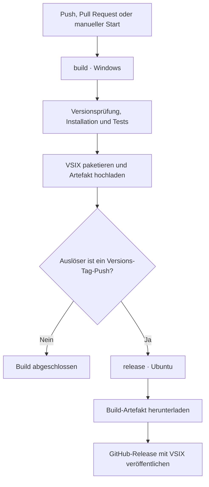

# Continuous Integration und Releases

[README](../README.md) · [Entwicklung und Architektur](ENTWICKLUNG.md)

## Konfiguration

Der Workflow [`.github/workflows/ci.yml`](../.github/workflows/ci.yml) definiert Tests, VSIX-Paketierung und tagbasierte GitHub-Releases. Voraussetzung ist ein GitHub-Repository mit aktivierten Actions und Zugriff auf die verwendeten Actions. Die Konfiguration verwendet GitHub-hosted Runner; die Kompatibilität mit anderen Actions-Implementierungen ist nicht zugesichert.

Workflow-Dateien werden versioniert und durch `.vscodeignore` aus dem VSIX ausgeschlossen.

## Trigger

| Ereignis | Build und Tests | Release |
| --- | --- | --- |
| Push auf einen Branch | Ja, für alle Branches | Nein |
| Push eines Tags mit Präfix `v` | Ja, einschließlich Versionsprüfung | Nach erfolgreichem Build |
| Pull Request | Ja, bei den standardmäßig unterstützten Pull-Request-Ereignissen | Nein |
| Manueller Start (`workflow_dispatch`) | Ja | Nein |

Der manuelle Start ist verfügbar, sobald der Workflow im Standardbranch liegt. Ein Push auf einen Branch mit offenem Pull Request kann sowohl einen Push-Lauf als auch einen Pull-Request-Lauf auslösen.



## Job `build`

Runner: `windows-latest`. Laufzeitlimit: 15 Minuten. Node.js: Version 22.

| Schritt | Implementierung | Ergebnis |
| --- | --- | --- |
| Checkout | `actions/checkout@v7` | Quellcode der auslösenden Referenz; Git-Anmeldedaten werden nicht dauerhaft hinterlegt. |
| Node.js | `actions/setup-node@v7` | Node.js 22 und npm-Downloadcache. |
| Paketinformationen | PowerShell, Schritt-ID `package_info` | Paketversion als Schritt- und Job-Output; Prüfung von Release-Tags. |
| Installation | `npm ci` | Installation anhand von `package-lock.json`. |
| Core- und Host-Tests | `npm test` | Verarbeitungssuite und Tests mit simulierter VS-Code-API. |
| UI-Tests | `npm run test:ui` | Headless-Chrome-Prüfungen mit simulierter VS-Code-Nachrichtenbrücke. |
| Paketierung | `npm run package` | `ezy-easy-yaml-<Version>.vsix`. |
| Artefakt-Upload | `actions/upload-artifact@v7` | Artefakt `ezy-extension`, Aufbewahrung 14 Tage. |

Die Schritte werden sequenziell ausgeführt. Bei einem Fehler entfallen die nachfolgenden Schritte. Eine fehlende VSIX-Datei wird durch `if-no-files-found: error` als Fehler behandelt.

Windows wird wegen der vorhandenen Chrome-Testkonfiguration verwendet. Die npm-Skripte führen den Webview-Build über ihre Hooks aus; ein zusätzlicher Build-Schritt ist nicht erforderlich. Der npm-Cache beschleunigt Paketdownloads, ersetzt jedoch nicht die Installation.

### Versionsprüfung

Für Tag-Referenzen gelten beide Bedingungen:

- Der Tag entspricht `^v[0-9]+\.[0-9]+\.[0-9]+$`.
- Der Tag entspricht exakt `v` gefolgt vom Wert aus `package.json.version`.

Vorabversionen und Build-Metadaten im Tag werden nicht unterstützt. Ein Versionskonflikt beendet den Build vor Installation und Tests. Eine Prüfung auf Zugehörigkeit des Tag-Commits zum Standardbranch findet nicht statt.

### Datenübergabe

| Wert | Herkunft | Verwendung |
| --- | --- | --- |
| `steps.package_info.outputs.version` | Ausgabe über `$GITHUB_OUTPUT` | Dateiname beim Artefakt-Upload. |
| `jobs.build.outputs.version` | Export des Schritt-Outputs | Zugriff im Release-Job über `needs.build.outputs.version`. |
| Artefakt `ezy-extension` | VSIX aus dem Build-Job | Übergabe der Paketdatei an den Release-Job. |

## Job `release`

Runner: `ubuntu-latest`. Laufzeitlimit: 5 Minuten. Abhängigkeit: erfolgreicher Job `build`.

Der Job läuft ausschließlich bei einem `push` auf eine Tag-Referenz mit Präfix `refs/tags/v`. Ein manueller Workflow-Start veröffentlicht keinen Release.

`actions/download-artifact@v8` lädt das Artefakt des aktuellen Workflow-Laufs nach `release-package/`. Anschließend veröffentlicht `gh release create` den Release mit folgenden Eigenschaften:

- Tag und Titel stammen aus der auslösenden Referenz.
- Das bereits gebaute VSIX wird ohne erneute Paketierung angehängt.
- `--verify-tag` verlangt einen vorhandenen Remote-Tag.
- `--generate-notes` erzeugt Release Notes über die GitHub API.
- `--repo` bestimmt das Ziel anhand von `GITHUB_REPOSITORY`.

Existiert der Release bereits, schlägt der Create-Befehl fehl. Vorhandene Releases und Assets werden nicht überschrieben. Die Aufbewahrungsfrist des Actions-Artefakts gilt nicht für das separat veröffentlichte Release-Asset.

Eine Veröffentlichung im VS-Code-Marketplace ist nicht konfiguriert.

## Berechtigungen

| Job | Berechtigung | Zweck |
| --- | --- | --- |
| `build` | `contents: read` | Repository-Inhalte lesen. |
| `release` | `contents: write` | GitHub-Release erstellen und Assets hochladen. |

Die GitHub CLI erhält den automatisch bereitgestellten Job-Token über `GH_TOKEN: ${{ github.token }}`. Ein persönlicher Access Token ist nicht erforderlich. Der Checkout verwendet `persist-credentials: false`.

## Release-Verfahren

Die Paketversion wird im vorgesehenen Veröffentlichungs-Commit aktualisiert. Der zugehörige Tag wird anschließend auf denselben Commit gesetzt und zum GitHub-Remote gepusht.

Beispiel für Version `0.1.3`; Remote, Branch und Versionsnummer sind an den Zielstand anzupassen:

```sh
npm version 0.1.3 --no-git-tag-version
git add package.json package-lock.json
git commit -m "Release 0.1.3"
git push <github-remote> <branch>

git tag -a v0.1.3 -m "EZY 0.1.3"
git push <github-remote> v0.1.3
```

Branch-Push und Tag-Push erzeugen getrennte Workflow-Läufe. Der Tag-Lauf prüft und paketiert den durch den Tag referenzierten Commit.

## Betrieb und Diagnose

Workflow-Status, Schrittprotokolle und Build-Artefakte sind unter **Actions** verfügbar. Veröffentlichte Versionen und deren VSIX-Dateien sind unter **Releases** verfügbar.

| Fehlerbild | Prüfung |
| --- | --- |
| Workflow startet nicht | Actions-Einstellungen, gepushte Workflow-Datei und Trigger prüfen. Für manuelle Starts muss die Datei im Standardbranch liegen. |
| Versionsprüfung schlägt fehl | Tagformat und Paketversion vergleichen. |
| UI-Test schlägt fehl | Chrome-Verfügbarkeit und Ausgabe des UI-Testschritts prüfen. |
| Artefakt fehlt | Ergebnis der Paketierung und erwarteten Dateinamen prüfen. |
| Release schlägt fehl | Token-Berechtigung, Remote-Tag, vorhandenen Release und heruntergeladenes Asset prüfen. |

Verpflichtende Pull-Request-Checks müssen zusätzlich über Repository-Regeln konfiguriert werden. Die Workflow-Datei definiert keine Merge-Sperren.

## Abdeckung und Grenzen

Die Pipeline umfasst Core-, Host- und UI-Prüfungen sowie die VSIX-Paketierung. Der vollständige VS-Code-Integrationstest (`npm run test:integration`) und ein Dependency-Audit sind nicht eingebunden.

Die npm-Befehle und die Versionsprüfung sind lokal ausführbar. Trigger, Runner-Umgebung, Token-Berechtigungen und Release-Veröffentlichung erfordern zur vollständigen Validierung einen GitHub-Lauf.

## Referenzen

- [GitHub Actions: Workflow-Syntax](https://docs.github.com/en/actions/reference/workflows-and-actions/workflow-syntax)
- [Checkout](https://github.com/actions/checkout) und [Node.js-Setup](https://github.com/actions/setup-node)
- [Artefakt-Upload](https://github.com/actions/upload-artifact) und [Artefakt-Download](https://github.com/actions/download-artifact)
- [GitHub CLI: Release-Erstellung](https://cli.github.com/manual/gh_release_create)
