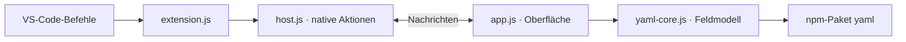

# Entwicklung und Architektur

[README](../README.md) · [Bedienungsanleitung](BEDIENUNG.md) · [CI und Releases](CI.md)

## Voraussetzungen

- Node.js ab Version 22 und npm.
- Desktop-VS-Code ab Version 1.85 für Entwicklung und Integrationstests.
- Chrome für UI-Tests; Standardpfad unter Windows oder expliziter Pfad über `EZY_CHROME`.

Alle Befehle werden im Repository-Hauptverzeichnis ausgeführt. Bei gesperrten PowerShell-Skripten kann `npm.cmd` anstelle von `npm` verwendet werden.

## Entwicklungsablauf

```sh
npm ci
npm run build
npm test
npm run test:ui
npm run package
```

F5 startet über `.vscode/launch.json` den Extension Development Host. Der vorgeschaltete Task baut die Webview automatisch. Tests und Paketierung führen den Build ebenfalls über npm-Hooks aus.

Das erzeugte `ezy-easy-yaml-<Version>.vsix` liegt im Hauptverzeichnis. Nach Installation eines Updates ist **Developer: Reload Window** erforderlich, damit Extension-Host und Webview denselben Versionsstand verwenden.

## Komponenten



| Komponente | Verantwortung |
| --- | --- |
| `extension.js` | Aktivierung, Befehlsregistrierung und Lebenszyklus des Controllers. |
| `host.js` | Webview-Verwaltung, Ressourcen-URLs, Sicherheitsrichtlinie, Dateidialoge, Dateizugriffe und Zwischenablage. |
| `media/app.js` | DOM-Darstellung, UI-Zustand, Eingabeereignisse und Kommunikation mit dem Host. |
| `media/yaml-core.js` | Parsing, Feldmodell, Auswahl, Werte, Listenoperationen, Konfigurationsimport und YAML-Ausgabe. |
| `media/webview.js` | Build-Einstieg; importiert Verarbeitungskern und Oberfläche in dieser Reihenfolge. |
| `media/index.html`, `media/styles.css` | HTML-Grundgerüst und Gestaltung der Webview. |

Der Extension-Host stellt Node.js und die VS-Code-API bereit. Die Webview läuft in einem Browser-Kontext und besitzt keine direkten Dateisystemrechte. Der Verarbeitungskern enthält keine DOM-, Netzwerk- oder Dateisystemzugriffe.

## Host-Protokoll

| Nachricht | Richtung | Zweck |
| --- | --- | --- |
| `ready` | Webview → Host | Signalisiert Empfangsbereitschaft. |
| `openTemplate`, `openConfig` | Webview → Host | Fordert Dateiauswahl und Dateiinhalt an. |
| `save`, `copy` | Webview → Host | Fordert Speicherung beziehungsweise Zwischenablagezugriff an. |
| `resetSession` | Webview → Host | Setzt den Sitzungszustand des Hosts zurück. |
| `templateLoaded` | Webview → Host | Bestätigt eine erfolgreich verarbeitete Vorlage. |
| `response` | Host → Webview | Liefert Daten oder Fehler zu einer Anfrage-ID. |
| `template` | Host → Webview | Übermittelt eine per VS-Code-Befehl gewählte Vorlage. |

Anfragen werden über numerische IDs mit Antworten verknüpft. `template` und `templateLoaded` sind eigenständige Mitteilungen. Eine vor Initialisierung der Webview gewählte Vorlage wird bis zum Empfang von `ready` zwischengespeichert.

Der Host verarbeitet eingehende Aktionen über eine Promise-Warteschlange. Die Oberfläche verwirft über einen Ladezähler veraltete asynchrone Ergebnisse. Dateizugriffe werden auf Dialogauswahl und Kontextmenüaufrufe begrenzt.

## Datenmodell und Kern-API

`parseTemplate()` erzeugt einen Feldbaum mit IDs, Pfaden, Typen, Vorlagenwerten, Quellpositionen und Hilfetexten. `createInitialSelection()` erstellt daraus einen unabhängigen Arbeitsstand mit Feldbaum und Bearbeitungszustand je Knoten-ID.

Der Bearbeitungszustand enthält `selected`, `type`, `value` und `error`. Auswahl und Wert werden getrennt verwaltet. `serializeSelection()` erzeugt YAML aus ausgewählten Feldern und deren erforderlichen Elternobjekten. Bei leerer Auswahl wird ein leerer String zurückgegeben; ungültige ausgewählte Werte führen zu `ConfigurationError`.

Die API steht innerhalb des Webview-Bundles über `globalThis.YamlStudio` bereit:

```javascript
const template = YamlStudio.parseTemplate('name: Beispiel\n');
const selection = YamlStudio.createInitialSelection(template);
const fieldId = template.root.children[0].id;

YamlStudio.setSelected(selection, fieldId, true);
YamlStudio.setValue(selection, fieldId, 'neuer Wert', 'string');
const output = YamlStudio.serializeSelection(template, selection);
```

Weitere Operationen: `importExport()` für den Import bestehender Konfigurationen, `addItem()` und `removeItem()` für Strukturanpassungen sowie `walk()`, `findNode()` und `getStatus()` für Navigation und Auswahlstatus.

Kommentar-Tokens stammen aus dem YAML-Parser. Ihre Zuordnung zu Feldern und Abschnitten erfolgt im Kern; Kommentare werden ausschließlich als Hilfetext verwendet.

## Tests

| Befehl | Abdeckung | Voraussetzungen |
| --- | --- | --- |
| `npm test` | Core-Suite und Host-Tests mit simulierter VS-Code-API. | Node.js und installierte npm-Abhängigkeiten. |
| `npm run test:ui` | Webview mit Host-HTML und CSP in Headless Chrome; simulierte VS-Code-Nachrichtenbrücke. | Chrome im Standardpfad oder `EZY_CHROME`. |
| `npm run test:integration` | Aktivierung, echte VS-Code-Webview, Dateizugriffe und Zwischenablage; ausgewählte Dialogantworten werden ersetzt. | Desktop-VS-Code im PATH oder ausführbare Datei über `EZY_CODE`. |

Die Verarbeitungssuite liegt in `test/core-suite.js` und verwendet die feste Momentaufnahme aus `test/fixtures/template.js`. Diese Fixture wird nicht automatisch mit `examples/template.yml` synchronisiert.

Der Integrationstest verwendet ein isoliertes Profil unter `.artifacts/` und stellt die Zwischenablage nach dem Test wieder her. Startprobleme werden in `.artifacts/vscode-integration-startup.log` protokolliert.

`EZY_EXTENSION_ROOT` kann für UI-Prüfungen auf das Verzeichnis `extension/` eines entpackten VSIX zeigen. Testberichte, Screenshots und Testprofile liegen unter `.artifacts/` und werden nicht ausgeliefert.

Zur manuellen Prüfung gehören Auswahl und Suche, teilweise ausgewählte Gruppen, Boolean-Werte einschließlich `false`, Listenänderungen, Speichern und erneuter Import sowie ungültige Dateien, Werte und abgebrochene Dialoge.

Die automatisierten Prüfungen und Release-Bedingungen sind in [CI und Releases](CI.md) dokumentiert.

## Build und Paketierung

`scripts/build.cjs` bündelt den Einstieg `media/webview.js`, die importierten eigenen Module und das npm-Paket `yaml` mit esbuild nach `dist/webview.js`. Nach Änderungen an den Webview-Sourcen ist ein neuer Build erforderlich.

Der Build erzeugt außerdem `dist/THIRD_PARTY_LICENSES.txt` aus den Metadaten und der ISC-Lizenz der installierten YAML-Abhängigkeit. `@vscode/vsce` erstellt das installierbare Paket.

| Pfad | Verwendung |
| --- | --- |
| `node_modules/` | Installierte Abhängigkeiten und Entwicklungswerkzeuge; von Git und VSIX ausgeschlossen. |
| `dist/` | Erzeugtes Bundle und Lizenzhinweise; von Git ausgeschlossen und im VSIX enthalten. |
| `.artifacts/` | Lokale Testausgaben; von Git und VSIX ausgeschlossen. |
| `examples/` | Mitgelieferte Beispielvorlage. |
| `docs/` | Projekt-, Bedienungs- und CI-Dokumentation. |
| `.vscode/` | Gemeinsame Debug- und Build-Konfiguration; vom VSIX ausgeschlossen. |
| `.github/workflows/` | GitHub-Actions-Konfiguration; vom VSIX ausgeschlossen. |

`.gitignore` steuert die Git-Ausnahmen, `.vscodeignore` den Paketinhalt. Das VSIX enthält Host-Code, Manifest, HTML, CSS, Bundle, Dokumentation, Beispielvorlage und Lizenzhinweise. Tests, Entwicklungswerkzeuge und bereits gebündelte Webview-JavaScript-Sourcen werden ausgeschlossen.

Die Paketierung verwendet die öffentliche Repository-URL und `--githubBranch main`, um relative README-Links für die Anzeige in VS Code aufzulösen.

Screenshot- und Icon-Quellen sowie deren Erzeugung sind in [Grafikdateien](GRAFIKDATEIEN.md) dokumentiert.

## Lizenz

Der Projektcode steht unter der MIT-Lizenz; siehe [LICENSE](../LICENSE). Für mitgelieferte Abhängigkeiten gelten deren jeweilige Lizenzhinweise.
